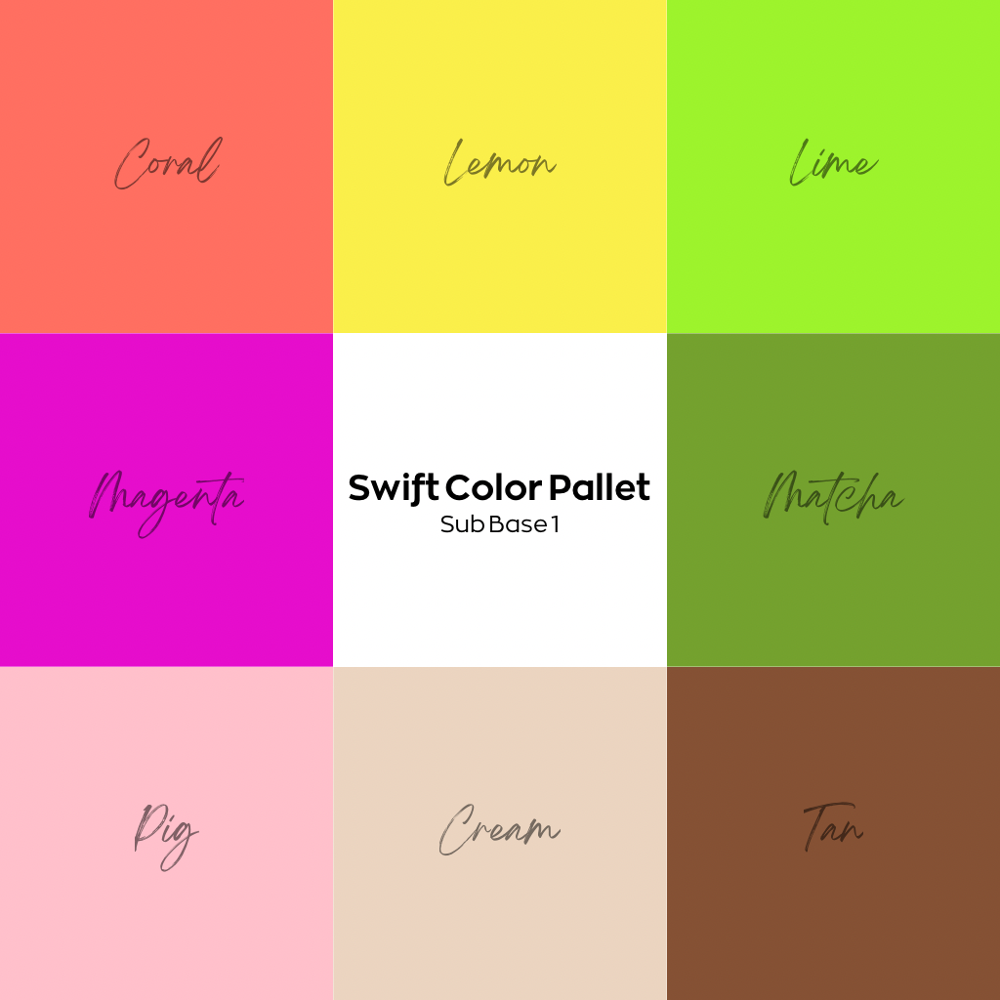
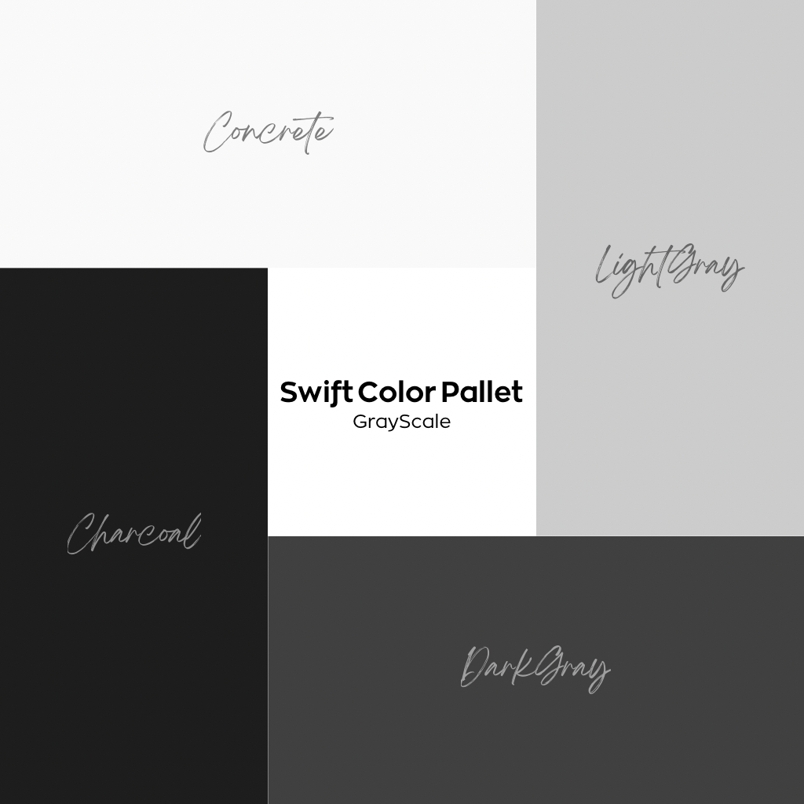

# Color Pallet
*/Color Pallet Ver: 1.1.7:1.1.7/*

A custom SwiftUI color palette featuring vibrant accent colors, warm earth tones, and clean neutral grays.
## How to use

## Colors

### SubBase1 Color

| Color | Swift Syntax | Hex Code | RGB |
| :--- | :--- | :--- | :--- |
| Coral | `.coral` | `#FF6F61` | 255, 111, 97 |
| Lemon | `.lemon` | `#FAEF4A` | 250, 239, 74 |
| Lime | `.lime` | `#9DF32C` | 157, 243, 44 |
| Matcha | `.matcha` | `#74A12E` | 116, 161, 46 |
| Tan | `.tan` | `#855134` | 133, 81, 52 |
| Cream | `.cream` | `#EBD4C0` | 235, 212, 192 |
| Pig | `.pig` | `#FFC0CB` | 255, 192, 203 |
| Magenta | `.magenta` | `#E60DCC` | 230, 13, 204 |

> Availible from version 1.1.7 and up.

### GrayScale Color

| Color | Swift Syntax | Hex Code | White Point / RGB |
| :--- | :--- | :--- | :--- |
| Concrete | `.concrete` | `#F9F9F9` | White: 0.975 (249, 249, 249) |
| Light Gray | `.lightGray` | `#CCCCCC` | White: 0.80 (204, 204, 204) |
| Dark Gray | `.darkGray` | `#404040` | White: 0.25 (64, 64, 64) |
| Charcoal | `.charcoal` | `#1D1D1D` | White: 0.1125 (29, 29, 29) |

 > Available from version 1.1.7 and up.
